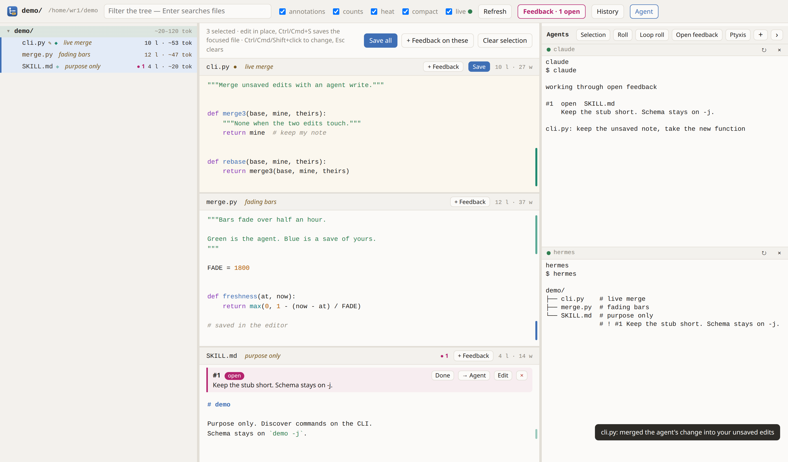

# treedit

[](https://github.com/wr1/treedit/actions/workflows/ci.yml)
[](https://codecov.io/gh/wr1/treedit)
[](https://pypi.org/project/treedit/)
[](https://pypi.org/project/treedit/)
[](LICENSE)
[](https://github.com/astral-sh/ruff)
[](https://github.com/pre-commit/pre-commit)

Editor and annotator aimed at agent assisted editing of skill trees.
Review a directory tree with an agent collaborator: annotate files and folders, leave feedback on
files, lines or the structure, and let the agent answer it from the CLI.
A [treeparse](https://github.com/wr1/treeparse) toolbox with a native (Tauri) window.

Working with an agent in a clone on another machine: Sync (and `treedit sync`) commits your edits,
pulls its commits, pushes yours, and merges annotations and feedback changed on both sides. A
work-file conflict is committed with its markers and pushed for the agent to resolve, by default.

Markdown files preview with Mermaid diagrams, and with D2 diagrams through the installed `d2` CLI.
A design Markdown file (a ```` ```mermaid ```` state diagram or flowchart, or a ```` ```d2 ```` graph,
plus one bullet tree per node under a heading or a top bullet named after the node; see
[examples/door-design.md](examples/door-design.md)) gets a **Design** button: the graph with each
node's tree as a transparent, foldable overlay. With the graph focused, `n`/`a` adds a node, `l`
then a click links the active node to another, arrows move it (Shift: bigger steps), Delete removes
it with its edges and tree, Esc cancels linking, Ctrl+Z undoes. Every edit is one small splice of
the Markdown in the editor beside it (change bars, drafts, save and undo as for typing); node
positions go to `.treedit-layout.json`, never into the Markdown.
The agent pane folds to a thin coloured strip on the right, one segment per running agent.
Right-click a Makefile (or a `*.mk`) in the tree and choose **Make targets…** to pick a target and
run it: the command goes into a shell that is already at its prompt (or into a new session if none
is free), from the Makefile's folder, so output streams live and the shell stays open afterwards.

The Roll queue at the bottom starts minimized. Expand it to see your saved edits, unsaved drafts,
changed annotations and open feedback since the last roll; untick anything that should wait, pick a
terminal, and **Roll** sends the list as one message. Images zoom with the scroll wheel and pan when
you drag them. A `.typ` file gets a **Compile PDF** button in its file bar: it saves the file, runs
`typst compile`, and opens the resulting PDF in the viewer (even when the output is gitignored).



## Install

```sh
uv tool install treedit      # or: pipx install treedit (Python 3.12+, Linux/macOS)
make tool                    # from a checkout: the CLI plus the native window (needs Rust; make app-deps)
```

Without the `treedit-app` window, `treedit open` uses your web browser.

## Discover

```sh
treedit -h                   # command tree
treedit -j                   # machine-readable JSON schema
treedit <cmd> -h             # one branch
```

## Development

```sh
make help
```

Releases: bump the version in `pyproject.toml` and `src/treedit/__init__.py`, update `CHANGELOG.md`, then
push a `vX.Y.Z` tag; the release workflow tests, publishes to PyPI and creates the GitHub release.

## License

MIT, see [LICENSE](LICENSE). Bundles [xterm.js](https://github.com/xtermjs/xterm.js) (MIT,
`src/treedit/vendor/LICENSE-xterm.txt`).
