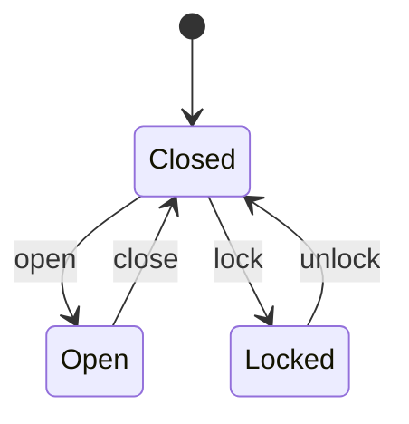

# Door controller

A small design file for treedit's Design mode: the state graph first, then one
tree per state. Prose like this paragraph stays untouched by graph edits.

## Graph

## Closed

- entry: motor off
- accepts
  - open (if not blocked)
  - lock
- shows: green LED

## Open

- entry: start the 30 s timer
- on timeout: close
  - beep twice first

## Locked

- entry: engage the bolt
- accepts
  - unlock (with a valid badge)

## Notes

Anything after the trees is ordinary Markdown.
